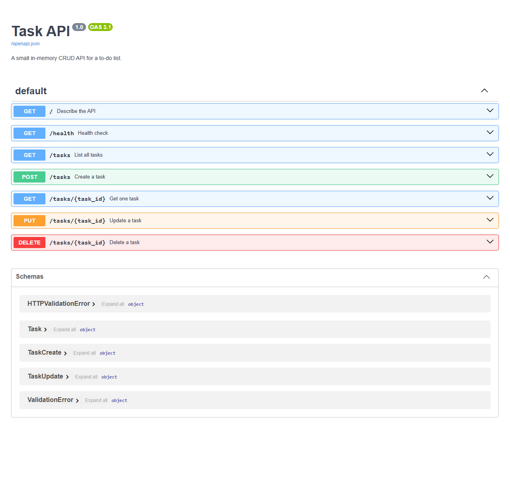

# Task API

A small CRUD API for a to-do list, built with Python and FastAPI.
Data is stored in memory only, so it resets when the server restarts.

## Run it

```bash
python -m venv .venv
source .venv/bin/activate        # Windows: .venv\Scripts\Activate.ps1
pip install -r requirements.txt
uvicorn main:app --reload
```

The API runs at http://localhost:8000 and Swagger UI at http://localhost:8000/docs.

Run the tests with:

```bash
pytest -q
```

## Endpoints

| Method | Path | Description | Success | Errors |
| --- | --- | --- | --- | --- |
| GET | / | API info | 200 | |
| GET | /health | Health check | 200 | |
| GET | /tasks | List all tasks | 200 | |
| GET | /tasks/{id} | Get one task | 200 | 404 |
| POST | /tasks | Create a task (`{"title": "..."}`) | 201 | 400 |
| PUT | /tasks/{id} | Update title and/or done | 200 | 400, 404 |
| DELETE | /tasks/{id} | Delete a task | 204 | 404 |

Errors come back as JSON, for example `{"error": "Task 99 not found"}`.

## Example

```
$ curl -i http://localhost:8000/tasks/1
HTTP/1.1 200 OK
date: Wed, 21 Oct 2026 08:24:54 GMT
server: uvicorn
content-length: 41
content-type: application/json

{"id":1,"title":"Learn HTTP","done":true}
```

## Swagger UI


